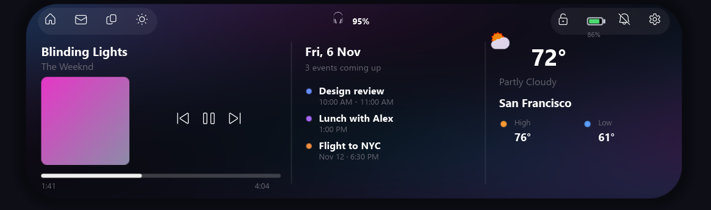
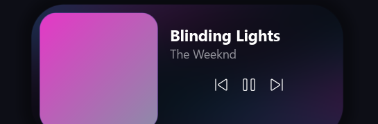

# WinLand — a native Dynamic Island for Windows

A faithful recreation of Apple's **Dynamic Island**, built as a real native
Windows app in **Rust** — **no Electron, no Chromium, no web stack**. A
transparent, always-on-top pill floats at the top-center of your screen and
fluidly morphs to show now-playing media, system indicators, and a full
multi-panel dashboard with your calendar and live weather.

Rendered with `wgpu` (DirectX 12 + DirectComposition) and a signed-distance-field
shader, so the shape morph is genuinely fluid and the whole thing stays light.

---

## Screenshots

**Full dashboard** — media, calendar, and weather at a glance, over an animated
backdrop that takes its colors from the album art:



**Now playing** (on hover) and the collapsed pill:




> The island is a transparent overlay; these shots use a solid backdrop and
> placeholder data.

---

## Features

- **Fluid morph** — SDF-shaped island animated by a spring integrator tuned to
  SwiftUI's `spring(response:0.5, dampingFraction:0.825)`.
- **Now Playing** — real system media (title, artist, album art, progress with
  elapsed/total times). **Hover to expand**, **click prev / play-pause / next**.
- **Click to open the full dashboard** — three panels:
  - **Media** — album art + controls + progress
  - **Calendar** — your real Google Calendar events (OAuth) + the date
  - **Weather** — live conditions, temperature, high/low (auto-located by IP)
  - A **top icon bar** (home, mail, clipboard, brightness, lock, battery,
    notifications, settings) wired to real Windows actions.
- **Animated background** — the whole island backdrop flows with color pulled
  from the current album art; reacts while playing, freezes when paused, drifts
  gently when idle.
- **System indicators** (transient pills): **volume**, **battery/charging**,
  **Bluetooth / earbuds connect**.
- **Earbuds battery** — shows your connected Bluetooth buds' battery, and
  **pauses playback when you put them in the case**.
- **Tray icon** — quit, run-at-login toggle, connect Google Calendar.
- **Permanent & light** — runs at login, single-instance, ignores Alt+F4,
  single ~12 MB `.exe` with no runtime dependencies.

---

## Install (prebuilt)

Grab the latest `winland.exe` from the
[**Releases**](../../releases) page and run it. That's it — it pins itself to
the top of your screen and (on first run) registers to start at login.

To quit: **right-click the tray icon → Quit WinLand**. (Alt+F4 won't close it —
it's meant to be a permanent overlay.)

> Windows 10/11, 64-bit. A GPU with DirectX 12 (virtually all modern PCs).

---

## Build from source

You need the Rust toolchain. The **MSVC** target (default on Windows) is
recommended:

```powershell
# 1. Install Rust: https://rustup.rs  (choose the default x86_64-pc-windows-msvc)
# 2. Clone & build
git clone https://github.com/GopeshKachhadiya/winland.git
cd winland
cargo build --release
# 3. Run
./target/release/winland.exe
```

The release binary is a single `target\release\winland.exe` with no runtime
dependencies.

<details>
<summary>Building with the GNU toolchain</summary>

If you use `x86_64-pc-windows-gnu`, you need a full MinGW-w64 (gcc + binutils
with `as` and `dlltool`) on `PATH` — the minimal `rust-mingw` component is not
enough for the `windows` crate's import libraries. A
[winlibs](https://winlibs.com) UCRT build works well.
</details>

---

## Usage

| Action | What happens |
|--------|--------------|
| **Hover** the pill | Expands to the now-playing panel |
| **Click** the island (not a control) | Opens / closes the full dashboard |
| **Click** prev / play-pause / next | Controls your media |
| **Click** a top-bar icon | Runs the matching Windows action (lock, settings, etc.) |
| **Move the cursor away** | Collapses back to the pill |
| **Tray → Quit WinLand** | Exits |
| **Tray → Start at login** | Toggles run-at-login |

---

## Connecting Google Calendar (optional)

The calendar panel shows your real Google Calendar events via OAuth. Because
this is an open-source desktop app, **you create your own free Google OAuth
credential** (so your calendar access stays entirely between you and Google):

1. Go to the [Google Cloud Console](https://console.cloud.google.com/) → create
   a project.
2. **APIs & Services → Library** → enable **Google Calendar API**.
3. **OAuth consent screen** → *External* → add your own email as a **test user**.
4. **Credentials → Create credentials → OAuth client ID** → application type
   **Desktop app** → copy the **Client ID** and **Client secret**.
5. Paste them into `%APPDATA%\WinLand\google.json`:
   ```json
   {
     "client_id": "YOUR_ID.apps.googleusercontent.com",
     "client_secret": "YOUR_SECRET",
     "refresh_token": null
   }
   ```
6. Restart WinLand (or tray → **Connect Google Calendar**). A browser opens —
   sign in and allow. Your upcoming events then appear in the dashboard.

Weather needs no setup; it auto-locates you by IP and uses the free
[Open-Meteo](https://open-meteo.com) API.

---

## Known limitations

- **Memory**: because it renders via `wgpu`/DX12, the GPU driver stack loads into
  the process (~150–170 MB working set — comparable to Electron). The disk
  footprint, startup, and idle CPU are far smaller. A software-rendering backend
  could cut memory to ~30 MB and is a possible future option.
- **Windows notifications mirroring** isn't implemented — `UserNotificationListener`
  needs packaged-app identity that a portable `.exe` can't get.
- **Brightness** control is best-effort (desktop monitors vary on DDC/CI).

---

## Contributing

Issues and PRs welcome. The code is organized by concern under `src/`
(`gfx`/`content`/`text`/`art` rendering, `state` morph, `media`/`system`/
`bluetooth`/`weather`/`gcal` integrations, `app` event loop).

## License

[MIT](LICENSE) © 2026 Gopesh Kachhadiya. Not affiliated with Apple. "Dynamic
Island" is a trademark of Apple Inc.; this is an independent, original
implementation for Windows.
